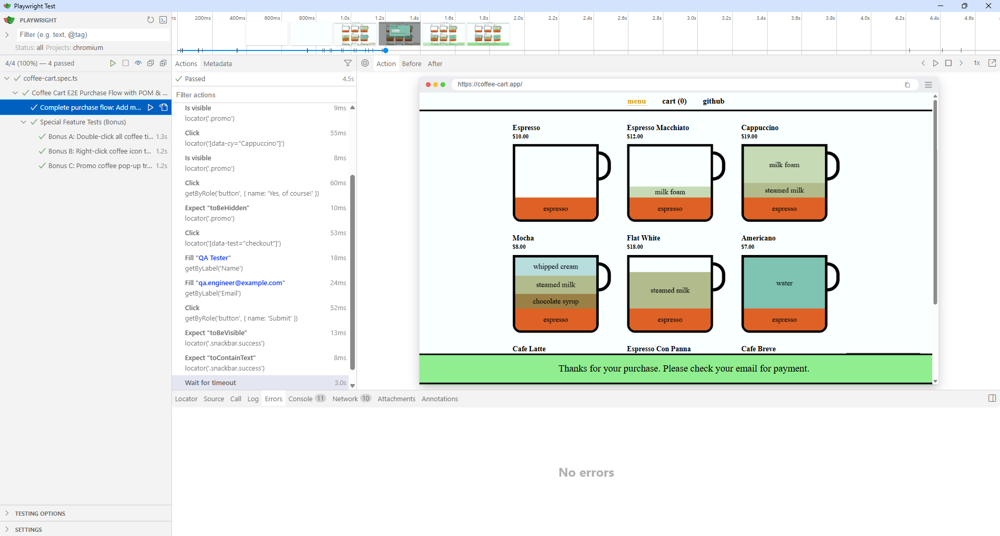
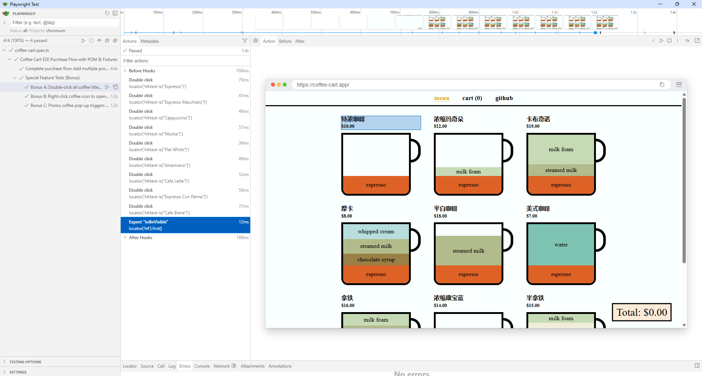
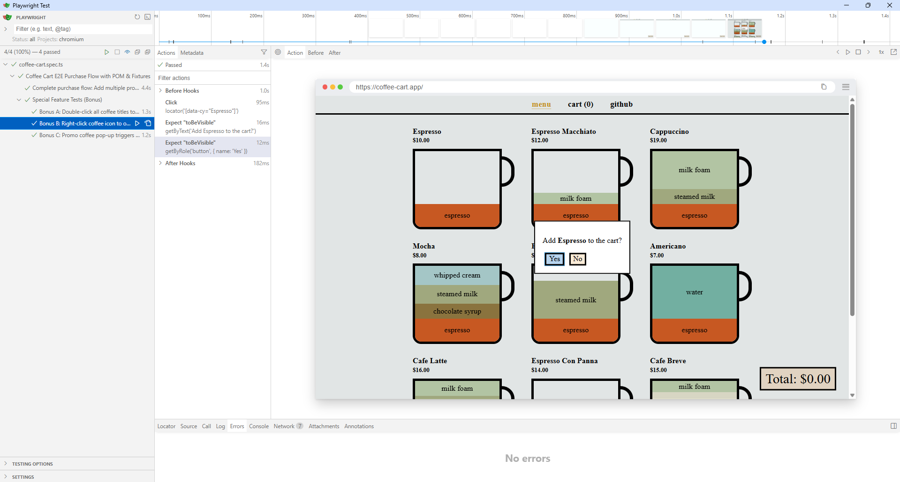
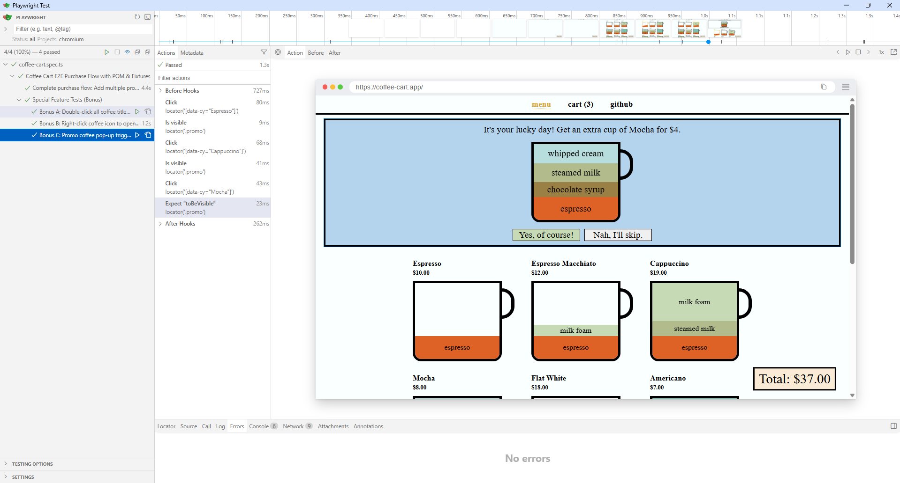

# Coffee-Cart-Automation

An end-to-end (E2E) test automation framework built with **Playwright** and **TypeScript** for [Coffee Cart](https://coffee-cart.app/). Designed with the **Page Object Model (POM)** pattern, custom fixtures, externalized test data, and automated CI/CD execution via GitHub Actions.

---

## Project Architecture

```text
Coffee-Cart-Automation/
├── .github/
│   └── workflows/
│       └── playwright.yml       # GitHub Actions CI pipeline
├── fixtures/
│   └── test-fixtures.ts         # Custom Playwright fixtures (POM & data injection)
├── pages/
│   ├── CatalogPage.ts           # Product catalog, promo modal, and bonus UI interactions
│   └── CheckoutModal.ts         # Payment submission and snackbar confirmation assertions
├── test-data/
│   └── checkout-data.json       # Isolated customer credentials and product lists
├── tests/
│   └── coffee-cart.spec.ts      # E2E purchase flow and bonus feature test specs
├── .gitignore                   # Excludes node_modules, playwright-report, and test-results
├── package.json
├── package-lock.json
├── playwright.config.ts         # Playwright configuration (baseURL, retries, reporters)
├── tsconfig.json                # TypeScript compiler configuration
└── README.md
```

## Key Features & Engineering Highlights

* **Page Object Model (POM):** Encapsulates page selectors and UI workflows inside `CatalogPage.ts` and `CheckoutModal.ts` for clean maintainability.
* **Custom Fixtures:** Eliminates boilerplate setup by injecting pre-initialized Page Objects and JSON test data directly into test blocks via `fixtures/test-fixtures.ts`.
* **Data-Driven Testing:** Separates customer details and coffee selections into `test-data/checkout-data.json` for easy scaling.
* **Resilient Locators & Auto-Waiting:** Uses exact `data-cy`, `data-test`, and scoped CSS selectors (`.promo`, `.snackbar.success`) to prevent strict mode violations and eliminate hardcoded `waitForTimeout` sleeps.
* **CI/CD Integration:** Configured with `.github/workflows/playwright.yml` to run tests automatically on push and pull requests, uploading HTML reports as artifacts.

---

## Test Coverage & Workflows

### Core E2E Purchase Workflow
This test validates the complete customer journey from browsing the catalog to finalizing payment:

* **Dynamic Product Selection:** Reads the list of target beverages from `checkout-data.json` and adds each item to the cart sequentially.
* **Conditional Promo Handling:** Monitors for the *"It's your lucky day!"* discount modal during cart additions and automatically accepts the extra promotional item (`Yes, of course!`).
* **Checkout & Payment Submission:** Opens the checkout modal via the total button and populates customer name and email fields using isolated test data.
* **Order Confirmation:** Verifies that the checkout modal closes and the green confirmation snackbar (`Thanks for your purchase. Please check your email for payment.`) appears at the bottom of the screen.

<!-- Replace the path below with your screenshot of the passing E2E flow or green success banner -->


---

### Bonus Feature Specs

#### Bonus A — Dynamic Title Translation
* **Behavior Tested:** Simulates a user double-clicking (`dblclick`) on coffee card headings (`h4`).
* **Verification:** Confirms that the application dynamically toggles the English beverage title into its corresponding Chinese translation.

<!-- Replace the path below with your screenshot of the translated coffee title -->


#### Bonus B — Right-Click Add-to-Cart Dialog
* **Behavior Tested:** Dispatches a context-menu right-click (`{ button: 'right' }`) directly onto a coffee card element (`[data-cy="Espresso"]`).
* **Verification:** Confirms that the custom quick-add confirmation dialog (`"Add Espresso to the cart?"` with **Yes** / **No** options) renders over the catalog.

<!-- Replace the path below with your screenshot of the right-click dialog -->


#### Bonus C — 3rd-Item Promo Pop-Up Trigger
* **Behavior Tested:** Adds three beverages sequentially while dismissing any earlier prompts.
* **Verification:** Confirms that the promotional discount modal (`.promo`) automatically triggers upon adding every third item to the cart.

<!-- Replace the path below with your screenshot of the 3rd-item promo modal -->

